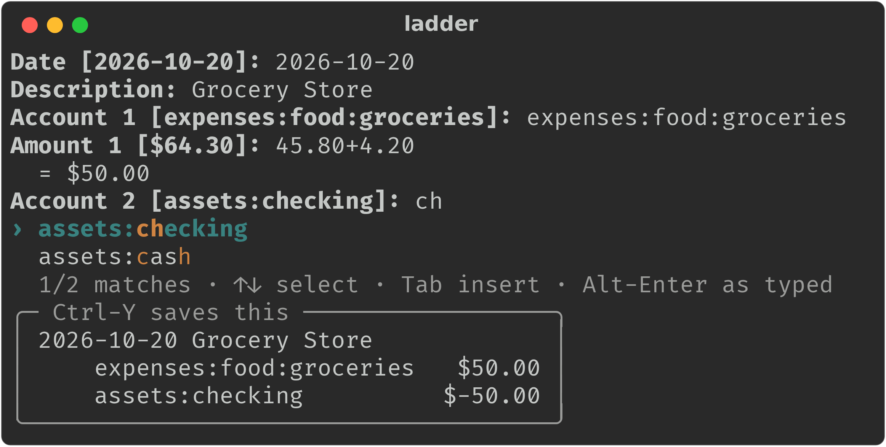

# ladder

A fast `hledger add` with fuzzy completion as you type, written in Rust.

It asks the same questions as `hledger add` (date, description, then account and
amount pairs until the transaction balances) and appends the result to your
journal. The difference is a live dropdown under the prompt that fuzzy-matches
your past descriptions and accounts on every keystroke.



## Install

```sh
cargo install --git https://github.com/plwg/ladder
```

Or from a local checkout:

```sh
cargo install --path .
```

## Usage

```sh
ladder                    # uses $LEDGER_FILE, else ~/.hledger.journal
ladder -f my.journal
ladder -f my.journal 2026-10-19 "Grocery Store"   # pre-fill the first answers
ladder --case title       # show past descriptions in Title Case (see below)
```

If stdin isn't a terminal, ladder falls back to plain line-by-line prompts,
so it can be scripted.

### Keys

| Key | Action |
| --- | --- |
| type | fuzzy-filter; space-separated terms all must match (fzf syntax: `^prefix`, `suffix$`, `'exact`, `!not`) |
| ↑ / ↓, Ctrl-P / Ctrl-N | move the selection (↑ past the top selects your typed text) |
| Tab | copy the selected match into the prompt for editing |
| Enter | accept the selection, else your typed text, else the `[default]` |
| Alt-Enter | accept exactly what you typed (use this for a new description) |
| Ctrl-Y | save the transaction shown in the preview box |
| Esc | clear the input; on an empty prompt, go back a step (or type `<`) |
| `.` | finish the transaction when it already balances |
| Ctrl-D / Ctrl-C | quit (an unfinished transaction is discarded) |

The usual editing keys also work: Ctrl-A, Ctrl-E, Ctrl-W, Ctrl-U and Ctrl-K.

### Behaviour

- **Ranking** combines match quality with how often and how recently each
  entry was used. The last few distinct entries get an extra boost, so a run of
  transactions against the same account keeps it at the top. A clearly better
  match still wins.
- **Description case**: spellings of a past description that differ only in
  case (`GROCERY STORE`, `Grocery Store`, `grocery store`) appear once, ranked by their combined use, and
  shown in the spelling you've used most. Choosing one saves it as shown and
  uses the most recent spelling's transaction as the template. `--case title`,
  `--case lower` or `--case upper` show every description in that case instead,
  and `--case original` shows each spelling separately.
- **Templates**: choosing a past description uses that transaction's accounts
  and amounts as defaults.
- **Preview**: a box under the prompt shows the transaction that would be
  saved: what you've entered so far, the answer Enter would give right now
  (the selected match, what you've typed, or the default), and the template's
  remaining postings, with the last amount balancing. It updates as you type,
  and Ctrl-Y saves it straight away, skipping the remaining prompts. The box is
  hidden when the transaction would still need input, e.g. two postings
  without an amount.
- **Balancing**: later amounts default to whatever balances the transaction. A
  bare number such as `12.5` takes the default's commodity and is written as
  `$12.50`.
- **Arithmetic**: amounts can be expressions using `+ - * /`, parentheses and
  unary minus, e.g. `S$(45.80 + 4.20)/3` or `10+2.5`. The result is rounded to
  the commodity's precision, shown as `= S$16.67`, and written to the journal as
  a plain amount.
- **Dates**: `today`, `y`, `tomorrow`, `-3`, `+2`, `19`, `10/19`,
  `2026-10-19` and `20261019`.
- **Comments**: text after `;` in a description or amount is kept as a comment.
- **Journal support**: `include` files, `account` and `commodity` directives,
  `comment` blocks, virtual postings, and prices (`@`, `@@`) when checking
  balance.
- Transactions you add are completable straight away in the same session.

## Performance

Measured on a synthetic 57 MB journal (500k transactions, 100k unique
descriptions):

- **Search**: about 1–4 ms per keystroke. Narrowing a query reuses the previous
  matches, and large lists are scored on all cores.
- **Loading**: about 160 ms. Large files are parsed in parallel chunks on a
  background thread while you type the date. Typical journals load in a few
  milliseconds.
- **Memory**: the journal text stays in memory and only the transaction you
  pick is fully parsed, so memory use is about the size of the journal.

Reproduce with:

```sh
cargo run --release --example bench -- my.journal "groc store"
```

To see how accounts rank for a query:

```sh
cargo run --release --example top -- my.journal "bank"
```

To check the ranking against your own history, replay your last N
transactions and count the keystrokes each set of ranking weights would need:

```sh
cargo run --release --example replay -- my.journal 50
```

## Limitations

- `include` with wildcards is skipped with a warning.
- New descriptions don't borrow a template from a similar past description;
  templates come only from the exact description you pick.
- Amounts you type are saved as written; only bare numbers are reformatted.

## License

MIT. See [LICENSE](LICENSE).
